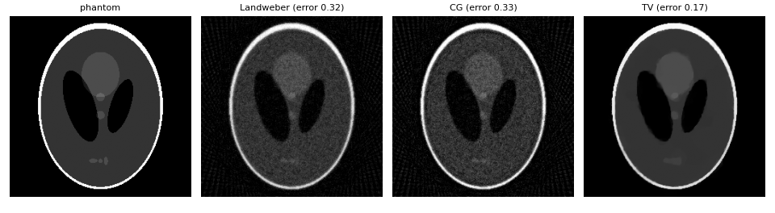
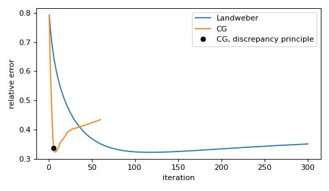
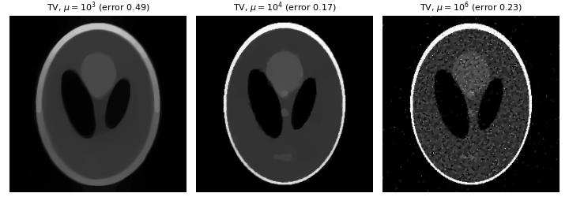

Reconstruction examples
=======================

This page illustrates the reconstruction functions of
:mod:`gratopy.reconstruction` with the operator API. All code is taken from
the script :download:`reconstruction_examples.py <examples/reconstruction_examples.py>`,
which also renders the figures below.

Setup
-----

We simulate sparse-angle data: 60 parallel-beam projections of a
:math:`256 \times 256` Shepp-Logan phantom with Gaussian noise of 2% of the
maximal sinogram value.

.. literalinclude:: examples/reconstruction_examples.py
   :language: python
   :start-after: # [setup]
   :end-before: # [end-setup]

Comparing the algorithms
------------------------

All reconstruction functions take the operator first, followed by the data.
Landweber and total variation require the operator norm; estimating it once and
passing it as ``operator_norm`` avoids repeating the estimate in every call.

.. literalinclude:: examples/reconstruction_examples.py
   :language: python
   :start-after: # [comparison]
   :end-before: # [end-comparison]

   The phantom and its reconstructions, with relative errors
   :math:`\|x - u\| / \|u\|` with respect to the phantom :math:`u`.

Landweber and conjugate gradients reproduce the noise in the data, while the
total-variation reconstruction suppresses it. As in
:func:`gratopy.total_variation`, the total-variation reconstruction is
constrained to be nonnegative.

Monitoring and early stopping
-----------------------------

After every iteration, the reconstruction functions call
``callback(iteration, x)`` with the current iterate. Here, the callbacks record
the error with respect to the phantom. Norms are taken in the operator's
spaces: ``R.domain`` for images and ``R.codomain`` for sinograms.

.. literalinclude:: examples/reconstruction_examples.py
   :language: python
   :start-after: # [monitoring]
   :end-before: # [end-monitoring]

   Relative errors of the Landweber and conjugate gradients iterates.

With noisy data, both iterations are semi-convergent: the error decreases at
first and increases again once the iteration starts to fit the noise. CG
reaches its smallest error within a few iterations, Landweber after about a
hundred.

In practice, the phantom is unknown, but an estimate of the noise level
:math:`\delta` often is available. The discrepancy principle stops at the
first iterate whose residual is at most :math:`\tau\delta` for some
:math:`\tau > 1`. Returning ``True`` from the callback stops the iteration:

.. literalinclude:: examples/reconstruction_examples.py
   :language: python
   :start-after: # [discrepancy]
   :end-before: # [end-discrepancy]

The resulting stopping point, marked in the figure above, is close to the
iterate with the smallest error.

Choosing the regularization parameter
-------------------------------------

The parameter ``mu`` of :func:`~gratopy.reconstruction.total_variation` weights
the data term; smaller values regularize more strongly. Reusing the operator
norm keeps such parameter studies cheap.

.. literalinclude:: examples/reconstruction_examples.py
   :language: python
   :start-after: # [parameters]
   :end-before: # [end-parameters]

   Total-variation reconstructions for different regularization parameters.

A small ``mu`` loses contrast and detail, whereas a large ``mu`` lets the
noise through.

Other geometries and slice stacks
---------------------------------

The reconstruction functions only use the operator interface, so they work the
same way for other geometries and for operator expressions, e.g., with a
fan-beam operator:

.. literalinclude:: examples/reconstruction_examples.py
   :language: python
   :start-after: # [geometries]
   :end-before: # [end-geometries]

Data with a trailing slice dimension is handled as for the operators:
:func:`~gratopy.reconstruction.landweber` and
:func:`~gratopy.reconstruction.conjugate_gradients` reconstruct the slices
independently, while :func:`~gratopy.reconstruction.total_variation` couples
neighboring slices according to ``slice_thickness`` (``0`` treats them
independently).
